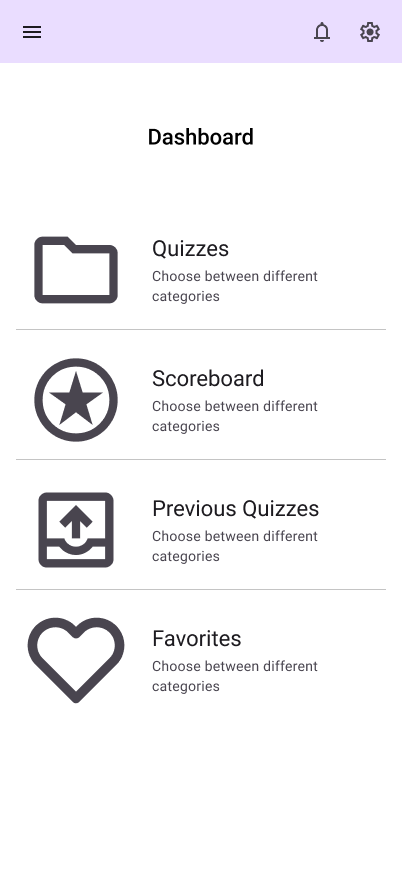
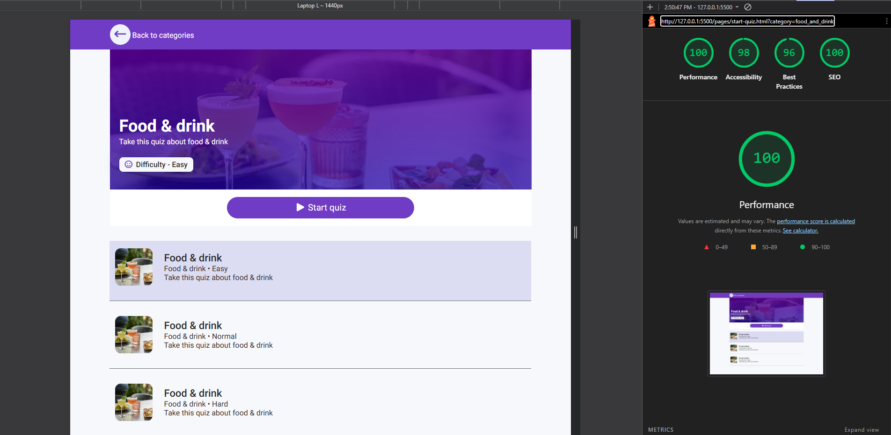

# Quiz App

**Team 5**
Gabriel, William, Elio, Andreas

**Publicerad app:**
[LÄGG IN LÄNK HÄR]

---

## Översikt

Quiz App är en webbaserad frågesport byggd i vanilla JavaScript. Användaren väljer en kategori och svårighetsgrad, spelar igenom ett antal frågor mot klockan och får sedan ett resultat som jämförs mot tidigare data. Frågorna hämtas från The Trivia API, men lokala frågor i `quizzes.json` prioriteras när de finns för vald kategori och svårighetsgrad. Pågående quiz, score och spelhistorik sparas i `localStorage`, vilket gör att ett quiz kan återupptas även om sidan laddas om.

Appen är uppdelad i sju vyer: **Dashboard**, **Categories**, **Start Quiz**, **Quiz Game**, **Result**, **Scoreboard** och **Previous Quizzes**. Navigationen är medvetet linjär från dashboard till kategori, vidare till val av svårighetsgrad, genom spelet och till sist resultatet men varje steg ger också användaren möjlighet att byta riktning, till exempel genom att välja en annan svårighetsgrad i samma kategori direkt från Start Quiz.

## Flöde

Flödet kan beskrivas som ett träd med tre grenar från dashboarden:

- **Quizzes** leder till Categories, där en kategori väljs och skickas vidare till Start Quiz.
- **Scoreboard** visar highscore per kategori och låter användaren borra ner i tidigare resultat.
- **Previous Quizzes** listar spelade quiz och låter användaren spela igen med samma kategori och svårighetsgrad.

Alla grenar möts till slut i Start Quiz, som i sin tur leder till Quiz Game och vidare till Result. Denna struktur gör navigationen förutsägbar utan att låsa användaren i ett enda spår.

# [Se App Struktur →](./planning/app-structure.md)

### Skisser

|               Dashboard               |                Start Quiz                 |
| :-----------------------------------: | :---------------------------------------: |
|  |  |

## Teknisk arkitektur

Projektet är modulärt uppdelat med ett tydligt ansvar per fil:

- **`config.js`** centrala konstanter som API-URL:er, svårighetsgrader, poäng och tidsgränser.
- **`api.js`** hämtar frågor och kategorier, med fallback till lokal data och felhantering för bland annat HTTP 429.
- **`storage.js`** kapslar in all `localStorage`-logik för quiz, score och historik.
- **`helpers.js`** återanvändbara verktyg som `formatName`, `formatTime`, `shuffle` och `createElement`.
- **Sidmoduler** en modul per sida med ansvar för rendering och händelser.

Denna uppdelning gör att logik kan ändras på ett ställe utan att påverka resten av appen, och att nya sidor kan byggas genom att återanvända befintliga moduler.

## Styrkor

**Säkrad API-fetch med localStorage.** Frågor cachas lokalt och quizet återupptas om sidan laddas om. API-anropet hanterar rate limiting (429), tomma svar och nätverksfel. När lokala frågor finns används de istället för API:et, vilket minskar beroendet av externa tjänster och gör appen snabbare.

**Tydlig modulstruktur.** Separeringen mellan config, API, storage och helpers gör koden lätt att navigera i och återanvända. Verktyg som `createElement` och `formatName` används konsekvent över alla sidor, vilket ger en enhetlig kodbas.

**Robust spellogik.** Timer, progressbar, svarsmarkering och fördröjning mellan frågor är genomtänkta. Exit-flödet använder en bekräftelsemodal och rensar endast oavslutade quiz, vilket skyddar användarens data.

**Användarvänlighet i kanterna.** Placeholder-bilder med `onerror`-fallback, disabled state på startknappen och tydliga felmeddelanden ger en trygg upplevelse även när något går fel.

## Svagheter

**Designen behöver mer kärlek.** Appen är i dagsläget en MVP funktionaliteten finns på plats men det visuella är just nu enkelt. Färgpaletten (`#59A2F6`, `#6D72F8`, `#403F3C`, `#94BBF9`, `#8F53F0`) är definierad men används inte fullt ut. Mer arbete behövs på spacing och animationer för att appen ska kännas färdig.

**Begränsad testning.** Det finns inga automatiska tester, vilket gör regressioner lättare att missa vid ändringar.

**Scoreboard och Result jämförs mot dummy-data** snarare än riktig användardata, vilket begränsar känslan av verklig konkurrens.

## AI-användning

AI-verktyg användes framför allt vid **felsökning och optimering**. Typiska användningsområden var att förstå felmeddelanden, förbättra felhantering i `api.js`, strukturera om moduler och hitta bättre lösningar på timer- och exit-logik.

**Granskning:** All AI-genererad kod lästes igenom och testades manuellt innan den integrerades. Vi kontrollerade att logiken stämde med befintlig kod, att variabelnamn och struktur följde projektets konventioner och att inga säkerhets- eller prestandaproblem infördes. AI användes som stöd inte som ersättning och alla beslut om vad som faktiskt skulle ingå i projektet fattades av teamet.

**Lighthouse test:**

